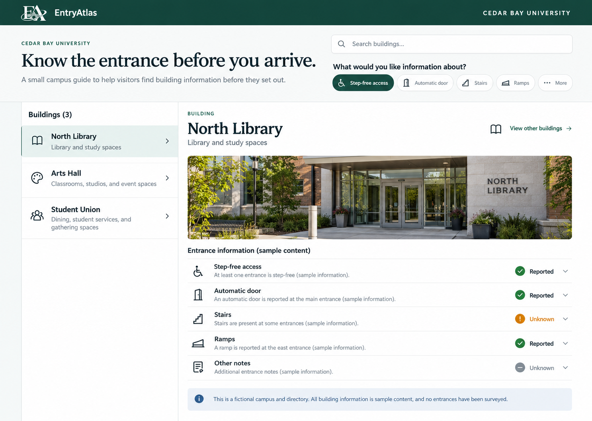
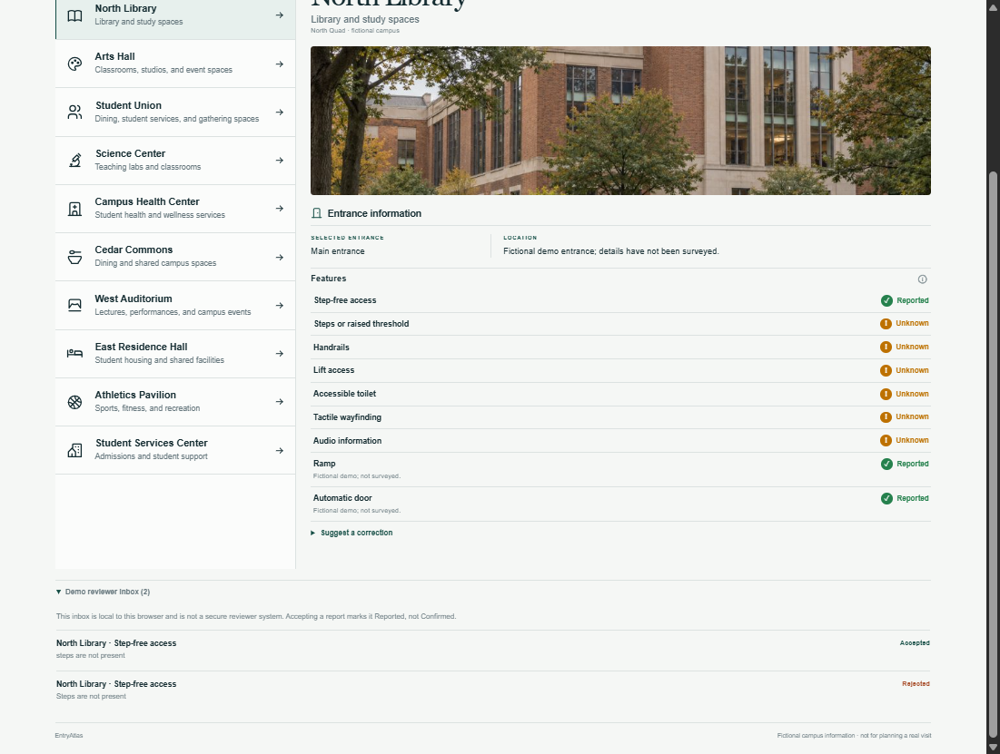
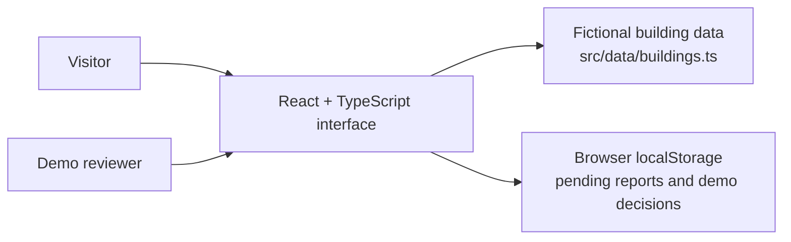

<div align="center">


# EntryAtlas

**Know the entrance before you arrive.**

Made by Kevin Dhyanesh V.R.

A campus entrance guide designed to help visitors, especially disabled visitors, understand what is known about a building before they set out.


[Workflow](#visitor-workflow) · [Features](#features) · [Architecture](#architecture) · [Run locally](#run-locally) · [Project status](#project-status)

</div>

> [!IMPORTANT]
> **This is a fictional-campus prototype.** Cedar Bay University, its buildings, entrance details, and example reports are sample content. No entrances have been surveyed. The directory does not provide real-world accessibility advice or guarantee that an entrance or route is usable.

---

## App preview



*The campus, building images, and entrance statuses shown here are fictional demonstration content.*



*After demo review: the accepted Step-free access report is shown as Reported; the inbox also shows a rejected report.*
## Visitor workflow

1. **Find a building** by searching the directory.
2. **Review entrance details** and the evidence status for each access feature.
3. **Suggest a correction** for a particular entrance and feature. It stays pending and does not change the displayed status yet.
4. **Review the report** in the demo inbox. Accepting it changes an unknown detail to **Reported**, not **Verified**.

## Features

| Area | What the prototype does |
|---|---|
| **Building directory** | Search 10 fictional campus buildings and open a building profile. |
| **Access information** | Review entrance details with **Verified**, **Reported**, or **Unknown** evidence labels. Unknown means that usable information has not been recorded; it does not mean “No.” |
| **Access needs** | Select common needs such as step-free access, automatic doors, stairs, ramps, handrails, lift access, tactile wayfinding, and audio information to surface corresponding recorded details. |
| **Corrections** | Submit a note about a building entrance or access feature. New notes enter the local demo inbox as pending and do not immediately change the displayed status. |
| **Demo review** | Accept or reject pending notes. Only after acceptance does an unknown detail change to **Reported** in this browser; acceptance does not verify the observation. |
| **Illustrative imagery** | View building images to help distinguish profiles. Images are illustrative and are not evidence about a real entrance. |
| **Responsive interface** | Use the directory on desktop or smaller screens, with keyboard focus indicators and reduced-motion support. |

## Architecture

EntryAtlas is currently a **frontend-only prototype**. Building records are defined in TypeScript source, and correction reports and reviewer decisions are saved in the current browser's `localStorage`.



There is no application server or shared database. Data saved in one browser is not available to other visitors or reviewers.

## Technology stack

| Layer | Technology |
|---|---|
| UI | React 19, TypeScript |
| Development and build | Vite 8 |
| Styling | CSS |
| Icons | Tabler Icons |
| Demo report storage | Browser `localStorage` |
| Package manager | pnpm |

## Run locally

**Requirements:** Node.js and pnpm. The repository declares pnpm `11.25.0` as its package manager.

```bash
pnpm install
pnpm dev
```

Vite prints the local development URL in the terminal. To create and preview a production build:

```bash
pnpm build
pnpm preview
```

## Data, privacy, and limitations

- The campus and its building records are fictional demonstration data.
- Reports and review decisions are stored in browser `localStorage`. They are local to that browser, editable by its user, and removed if that storage is cleared.
- There is no sign-in, shared moderation service, server-side access control, or production backend.
- Accepting a report labels a detail **Reported**. It does not independently confirm or verify the report.
- The prototype does not provide accessible-route planning, live lift or entrance outage data, or guarantees about safety or usability.
- Illustrations and sample records must not be used to make decisions about a real campus visit.

## Project status

The current goal is to demonstrate how visitors might find entrance information and how a correction could be reviewed. Before use on a real campus, EntryAtlas would need a real, maintained data source; secure, shared review tools; clear observation dates and evidence; and accessibility evaluation with disabled visitors.

| Stage | Status |
|---|---|
| Search and browse fictional building profiles | Implemented |
| Display entrance feature evidence labels | Implemented as demonstration content |
| Submit and review corrections in one browser | Implemented as a local demo flow |
| Shared backend, authentication, and reviewer permissions | Not implemented |
| Surveyed campus information and update ownership | Not implemented |
| Real-world accessibility evaluation and pilot | Not implemented |

## Project structure

```text
images1.png                  Main app preview
images2.png                  Review-state screenshot
src/
  App.tsx                    Main directory, building profile, and demo review flow
  components/
    FeatureReportForm.tsx    Visitor correction form
    NeedsSelector.tsx        Access-need controls
  data/
    buildings.ts             Fictional campus and building records
  styles.css                 Application styles and responsive behavior
public/
  images/                    Illustrative building images
  entryatlas-logo.jpeg       Project logo
  manus-routes.json          Preview route configuration
docs/
```

## Build check

```bash
pnpm build
```

This runs the TypeScript check and creates the production bundle in `dist/`.


